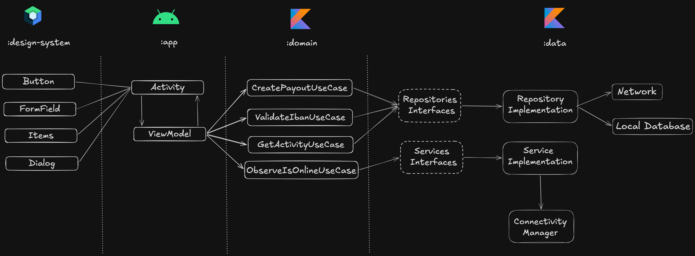

## How to build and run the project

**Requirements:** Android Studio with Android SDK 36, or JDK 17 and the Android SDK for the command line. A device or emulator running API 26 or newer.

**Android Studio:** open the project root, wait for the Gradle sync, select the `app` configuration and press Run.

**Command line:** with an emulator running or a device connected:

```bash
./gradlew :app:installDebug
adb shell am start -n com.example.androidinterview/.core.MainActivity
```

**Unit tests and coverage:**

```bash
./gradlew :app:testDebugUnitTest :data:testDebugUnitTest :domain:test
./gradlew jacocoUnitTestReport
```

The second command also runs the tests, and writes its report to `app/build/reports/jacoco/jacocoUnitTestReport/html/index.html`.

## Tech stack, libraries and AI Tools

- Minimum SDK level 26, targeting SDK 36.
- [Kotlin](https://kotlinlang.org/) based, using [Coroutines](https://github.com/Kotlin/kotlinx.coroutines) and [Flow](https://kotlinlang.org/docs/flow.html) for asynchronous work.
- Jetpack libraries:
  - [Compose](https://developer.android.com/compose) with Material 3: declarative UI.
  - [Navigation 3](https://developer.android.com/guide/navigation/navigation-3): a back stack owned by the app, which survives process death.
  - [Lifecycle](https://developer.android.com/topic/libraries/architecture/lifecycle): lifecycle-aware state collection and screen effects.
  - [ViewModel](https://developer.android.com/topic/libraries/architecture/viewmodel) with [SavedStateHandle](https://developer.android.com/topic/libraries/architecture/viewmodel/viewmodel-savedstate): UI state that survives configuration changes, and a payout form that survives process death.
  - [Biometric](https://developer.android.com/jetpack/androidx/releases/biometric): `BiometricPrompt` and `BiometricManager` for payouts over the threshold.
  - [Security Crypto](https://developer.android.com/jetpack/androidx/releases/security): `EncryptedSharedPreferences`, backed by the Android Keystore, for the device ID.
- Architecture:
  - MVVM with a layered, multi-module structure: `:app` (UI), `:domain` (business rules), `:data` (networking and storage) and `:design-system` (reusable UI).
  - Repository pattern, with the interfaces in `:domain` and the implementations in `:data`.
  - Constructor injection through a small composition root, with no dependency injection framework.
- [Retrofit](https://github.com/square/retrofit) and [OkHttp](https://github.com/square/okhttp): HTTP client for the API.
- [OkHttp MockWebServer](https://github.com/square/okhttp/tree/master/mockwebserver): the local API server provided with the challenge.
- [Kotlin Serialization](https://github.com/Kotlin/kotlinx.serialization): JSON parsing without reflection.
- Testing:
  - [JUnit 5](https://junit.org/junit5/): unit test framework.
  - [MockK](https://mockk.io/): mocks for Kotlin.
  - [kotlinx-coroutines-test](https://github.com/Kotlin/kotlinx.coroutines/tree/master/kotlinx-coroutines-test): virtual time for coroutine tests.
  - [JaCoCo](https://www.jacoco.org/jacoco/): unit test coverage across modules.
- [GitHub Actions](https://docs.github.com/actions): runs the unit tests and checks coverage on every pull request.
- AI tools:
  - [Claude Code](https://claude.com/claude-code) with Claude Opus 5.5: pair programming on the implementation. I led the design, tested manually on the emulator and reviewed the code in the [pull requests](https://github.com/manoellribeiro/merchant-payout-app-challenge-android/pulls?q=is%3Apr+state%3Aclosed).
  - [Android CLI](https://developer.android.com/tools/agents/android-cli): Google's command-line tool for building Android apps with agents.
  - [Official Android skills](https://github.com/android/skills): `jetpack-compose-performance` and `navigation-3`, used when writing the Compose screens and the navigation.
  - `unit-test` skill and `test-writer` agent (`.claude/skills` and `.claude/agents`): my own unit test conventions, which I wrote for another project and adapted here. The agent wrote the unit tests by following them.

## Architecture

The app follows MVVM and the Repository pattern, in line with [Google's guide to app architecture](https://developer.android.com/topic/architecture), and adds the optional domain layer.



### Architecture overview

- Each layer follows [unidirectional data flow](https://developer.android.com/topic/architecture/ui-layer#udf): the UI sends user events down to the ViewModel, and state comes back up as a `StateFlow`.
- Dependencies point inwards. `:domain` is at the center and depends on no other module, so business rules don't change when the UI or the data sources do.

### UI layer (`:app`)

Compose screens render a single `UiState` and send user events to their [ViewModel](https://developer.android.com/topic/libraries/architecture/viewmodel), which only talks to use cases. Every screen has a sealed `UiState` with all its states. One-shot events go through a `SharedFlow`, so a rotation can't repeat them.

`:app` also owns what needs an Activity (the biometric prompt and the screen capture protection) and `AppContainer`, the composition root that creates the implementations and the ViewModel factories.

**Key decisions:**

- **`MutableStateFlow` instead of `stateIn(WhileSubscribed(5_000))`:** these are one-shot loads with no upstream flow to share, and sequential functions launched in `viewModelScope` are simpler to read. The trade-offs: Home reloads on rotation, and a slow balance holds back an activity result that has already arrived. Balance and activity still load concurrently, so slow activity never delays the balance.
- **The screen runs the biometric prompt, not the ViewModel:** a common pattern injects a `BiometricAuthenticator` into the ViewModel, but `BiometricPrompt` needs a `FragmentActivity`. So the ViewModel emits a one-shot event, the screen runs the prompt, and the result comes back as an action. The ViewModel stays testable with no hardware or Activity. The prompt is created with the screen, so its result survives a rotation.
- **Form state in `SavedStateHandle`:** it survives process death and is cleared on success, so a completed payout can't come back filled in. The IBAN therefore sits in saved instance state until then.
- **`FLAG_SECURE` per screen through `LifecycleResumeEffect`:** it's the Compose equivalent of adding the flag in `onResume` and clearing it in `onPause`, needed because one Activity hosts every screen. It also covers the payout outcome screens, following the root README's "Payout screens". Android can block capture because the OS composites windows and honours the flag; iOS has no equivalent, so apps there can only detect a screenshot afterwards.
- **Screenshot warning on API 34+ only:** that's where detection exists, and it still fires with the flag on, so the capture is black and the reminder shows. Older versions are still blocked, with no reminder.

### Domain layer (`:domain`)

A pure Kotlin module, with no Android dependency, so its rules run as plain JVM tests. It holds the models, the use cases with the business rules (biometric threshold, IBAN validation, pence and pounds conversion) and the repository and service interfaces.

**Key decisions:**

- **Repository interfaces live here, not in the data layer:** this is Dependency Inversion, because `:data` depends on `:domain` and never the other way round. Gradle enforces it: `:domain` can't import Retrofit or Android.
- **`Money` is a `Long` in minor units:** `BigDecimal` is used for parsing and formatting, and `Double` or `Float` never are. Fraction digits come from `java.util.Currency`, so nothing hard-codes `100`.
- **Biometric thresholds in major units, passed through the constructor:** the rule is "over", so exactly £1,000 skips the prompt. A currency with no threshold requires biometrics, which is the safe default.

### Data layer (`:data`)

Implements the interfaces from `:domain`:

- **Repositories** provide data: `MerchantRepository` calls the API, and `DeviceIdentityRepository` keeps the device ID in `EncryptedSharedPreferences`.
- **Services** wrap Android system services and expose device state instead of data, which is why they aren't called repositories: `ConnectivityService` uses `ConnectivityManager.NetworkCallback`.

**Key decisions:**

- **`Result<T>` with a sealed `DataError`, and no `runCatching`:** the UI handles each failure exhaustively, and `runCatching` around suspend calls would also swallow `CancellationException`.
- **Device ID is a local UUID, not `GET /api/devices`:** this is what the requirements ask for, and the mock regenerates that endpoint's ID per process.
- **Device ID generated at the first payout, not on first launch:** it avoids Keystore and disk work at startup, and the ID is only needed when a payout is sent. It stays stable across launches.
- **`EncryptedSharedPreferences` despite its deprecation:** the device ID identifies the device that sends payouts, so it's kept encrypted with a Keystore-backed key. The alternative would be a Keystore key with DataStore.

### Design system (`:design-system`)

Theme tokens and reusable Compose components. It knows nothing about the business: it receives formatted strings and simple flags, instead of domain types, so it depends on no other module and its components can be previewed alone.

## Modularization

- **Strict visibility control:** everything in `:data` is `internal` except `DataLayerFactory`, so `:app` only sees the interfaces from `:domain`.
- **Reusability:** `:design-system` can be used by another app or a component catalog without bringing any business code.
- **Faster builds:** a change inside one module doesn't rebuild the modules that don't depend on it.

For more information, see the [guide to Android app modularization](https://developer.android.com/topic/modularization).

## Others decisions

- **No dependency injection framework:** plain constructor injection through `AppContainer` is enough for this size. It's the only file in `:app` that imports `:data`.
- **`annotation-experimental` 1.5.1:** a workaround for a known Android Studio false error on `@Serializable` classes (KTIJ-31549). The Gradle build never reported it.

## What you would improve or add with more time

**Payout reliability**

- **Reconciliation through `GET /api/payouts/:id`:** after a dropped connection the app only says the outcome is unknown. It could look the payout up and show the real result.
- **Bind the biometric prompt to a `CryptoObject`:** today nothing proves to the server that the step-up happened. Signing the payout with a Keystore key that requires biometrics would give it that proof.

**Scale**

- **Thresholds per currency from a remote source:** they could change without an app release, behind a `:domain` interface, so `ShouldRequestBiometricUseCase` doesn't change. They'd be fetched ahead of time and cached, so Confirm never waits on the network, with bundled defaults on first launch. If the fetch fails or a currency is missing, biometrics would be required.
- **Supported currencies from a remote source:** `Currency` and `RemoteCurrency` are enums today, so adding a currency needs a release.
- **Enable R8 in release:** `isMinifyEnabled` is `false` today, so the release build isn't shrunk, optimized or obfuscated, and there are no keep rules. Turning it on means adding any keep rules the app needs and testing the biometric and secure flows again on a release build.
- **Performance tracing with Perfetto:** custom `androidx.tracing` sections around the Home load and the payout flow, and Macrobenchmark tests for startup and the transactions scroll, with the traces analysed in Perfetto. This would catch slowdowns as screens and features grow. It depends on R8 being enabled, because debug numbers aren't representative.

**Observability**

- **A small `PayoutTelemetry` interface with a Logcat implementation:** it would cover the payout funnel (form submitted, biometric required and its result, payout succeeded or failed by error type, offline shown), load errors and API latency. It would never log the IBAN or personal data, and would bucket amounts if it logged them at all.
- **Mapping it to production:** Crashlytics non-fatals, Datadog or custom traces, alerts on payout success rate, and dashboards per currency and app version.

**Testing**

- **Integration tests:** instrumented tests of the payout flow against MockWebServer, including the `99999` and `88888` triggers, and of `EncryptedDevicePreferences`, which has no unit tests because it needs a real Android Keystore that the JVM doesn't have.

## What I left out and why

- **Per-section reload on Home:** Try Again reloads both sections. I tried reloading only the failed one and left it out, because passing a load target into `loadHome` added more complexity than the benefit justified.
- **Feature modules (`:feature:payout`) depending only on `:domain`:** one developer and three screens don't need them yet. The cost is that keeping presentation away from `:data` is a convention, because `:app` needs it for `AppContainer`. Feature modules would let Gradle enforce it.
- **A catalog app for the design system:** the challenge doesn't ask for one, and each component already has previews.
